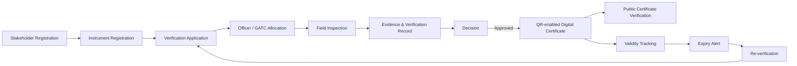
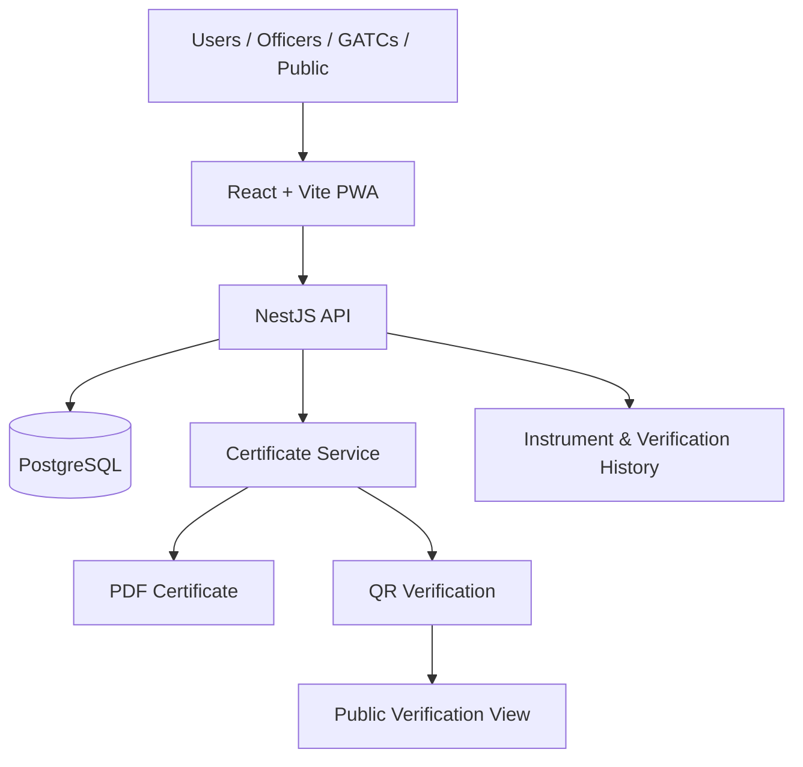

# MeterX — SIH26036

> **Online Verification System for Weighing & Measuring Instruments**

MeterX is a Smart India Hackathon 2026 project for **SIH26036**, focused on digitising the verification, certification, and lifecycle management of weighing and measuring instruments used under Legal Metrology.

**Live Demo:** `https://meterix-sih.vercel.app/`  
**Source Code:** Private due to SIH project restrictions  

> **Note:** This repository is a public project showcase. The production/SIH implementation is intentionally kept private.

---

## Why MeterX

The existing verification lifecycle can involve fragmented records and manual steps across application submission, scheduling, inspection, certificate issuance, validity tracking, and re-verification.

MeterX brings that workflow into one digital system so stakeholders can apply online, officers can manage inspections, verification evidence can be recorded, and certificates can be issued and checked digitally.

## Core Features

- Digital stakeholder and instrument registration
- Verification and re-verification applications
- Officer / GATC allocation and scheduling
- Field-inspection evidence capture
- Instrument verification history
- Rule-driven verification workflow
- QR-verifiable digital certificates
- PDF certificate generation
- Public certificate verification
- Certificate validity and expiry tracking
- Re-verification workflow and alerts
- Role-based access for different stakeholders

## Main Roles

| Role | Purpose |
| --- | --- |
| Instrument Owner / Business | Register instruments, submit applications, track verification status |
| Legal Metrology Officer | Review applications, conduct or manage verification activities |
| Government Approved Test Centre | Participate in authorised testing / verification workflows |
| Department Administrator | Manage platform-level workflow and records |
| Public User | Verify certificate authenticity using certificate details / QR |

## Tech Stack

| Layer | Technology |
| --- | --- |
| Frontend | React, Vite, TypeScript |
| Mobile-friendly experience | Progressive Web App (PWA) |
| Backend | NestJS |
| Database | PostgreSQL |
| Certificates | PDF + QR verification workflow |
| Deployment | Vercel demo deployment |

## System Flow



## High-Level Architecture



More detail: [docs/ARCHITECTURE.md](docs/ARCHITECTURE.md)

## Public Demo

This repository is a **showcase repository**, not the production/source repository.

The deployed demo can be linked here:

```text
https://meterix-sih.vercel.app/
```

### Demo disclaimer

MeterX is a student prototype created for Smart India Hackathon 2026. It is **not an official Government of India / Legal Metrology service**.

## Screenshots

Add real screenshots from your deployed MeterX build to the `screenshots/` directory.

Recommended set:

1. Landing / dashboard
2. Instrument registration
3. Verification application
4. Officer / inspection workflow
5. Instrument history
6. QR-enabled certificate
7. Public certificate verification
8. Expiry / re-verification view

See [screenshots/README.md](screenshots/README.md).

## Repository Scope

This repository intentionally contains:

- project overview
- feature documentation
- architecture documentation
- live-demo reference
- screenshots you choose to publish

It intentionally does **not** contain:

- application source code
- API implementation
- database credentials
- environment files
- private SIH material
- secrets or deployment tokens

See [docs/PRIVACY.md](docs/PRIVACY.md).

## SIH Context

- **Problem ID:** SIH26036
- **Problem:** Development of an Online Verification System for Weighing and Measuring Instruments
- **Category:** Software
- **Organisation:** Ministry of Consumer Affairs, Food & Public Distribution
- **Department:** Department of Consumer Affairs

## Status

**Portfolio / SIH demonstration repository**

The working implementation remains private. This public repository exists so recruiters, mentors, and reviewers can understand the problem, architecture, feature scope, and access the deployed demo without exposing the private codebase.

---

### Author

**Kalvakota Sai Anudeep**  
GitHub: `https://github.com/Alchemist-fullmetal`
