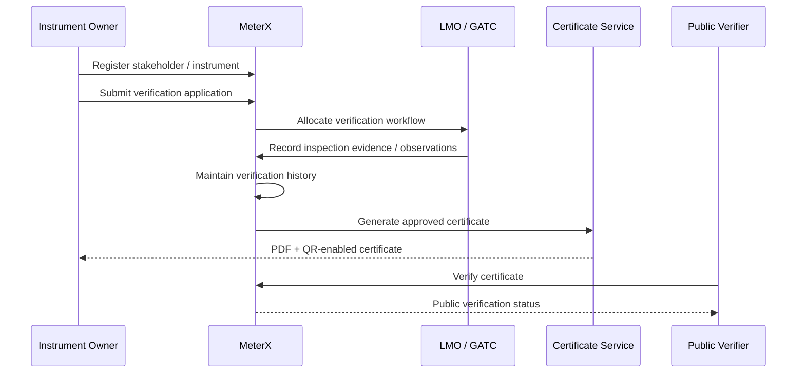

# MeterX Architecture

This document gives a high-level public architecture view without exposing private implementation details.

## Components

### 1. React + Vite PWA

The user-facing application provides workflows for:

- stakeholder registration
- instrument registration
- verification / re-verification applications
- status tracking
- inspection workflows
- certificate access
- public certificate verification

The PWA approach allows the interface to remain mobile-friendly for field-oriented workflows.

### 2. NestJS Backend

The API layer coordinates application workflow, role-based operations, instrument records, verification state, certificate generation, and public verification requests.

Implementation details are intentionally omitted from this public repository.

### 3. PostgreSQL

The relational database is used for structured platform data such as:

- stakeholders
- instruments
- applications
- verification records
- inspection evidence metadata
- certificates
- lifecycle / validity information

No schema dump or private database material is included here.

### 4. Certificate Workflow

When a verification reaches an approved state, the platform can produce a digital certificate represented by a PDF and linked to a QR-based verification flow.

The public verification path is designed to allow a certificate to be checked without exposing private administrative data.

## End-to-End Lifecycle

## Design Goals

- clear lifecycle tracking
- auditable verification history
- role separation
- digital certification
- public authenticity checking
- expiry visibility
- straightforward re-verification

## Non-Goals

MeterX does not physically test or calibrate measuring instruments. It digitises and manages the verification, evidence, certification, and lifecycle workflow around those activities.
